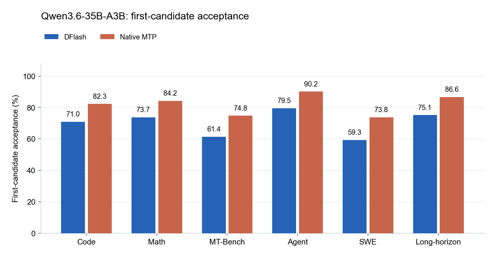
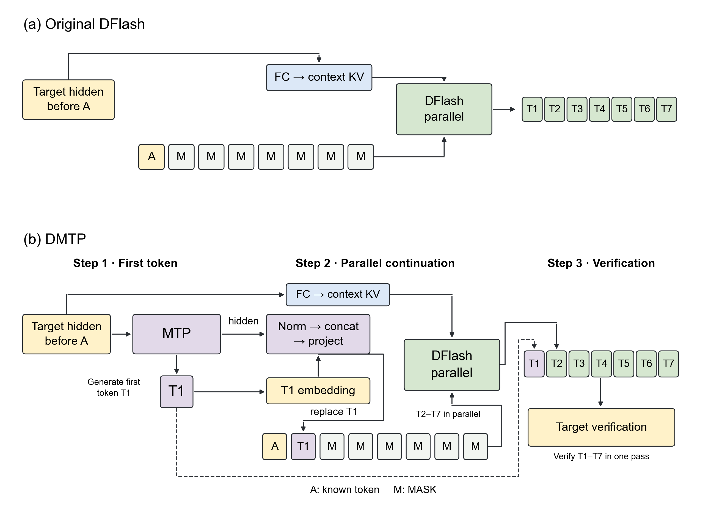
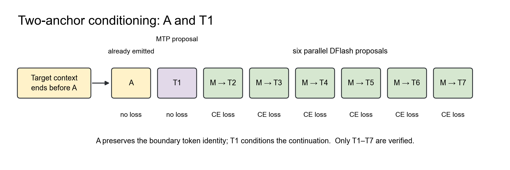
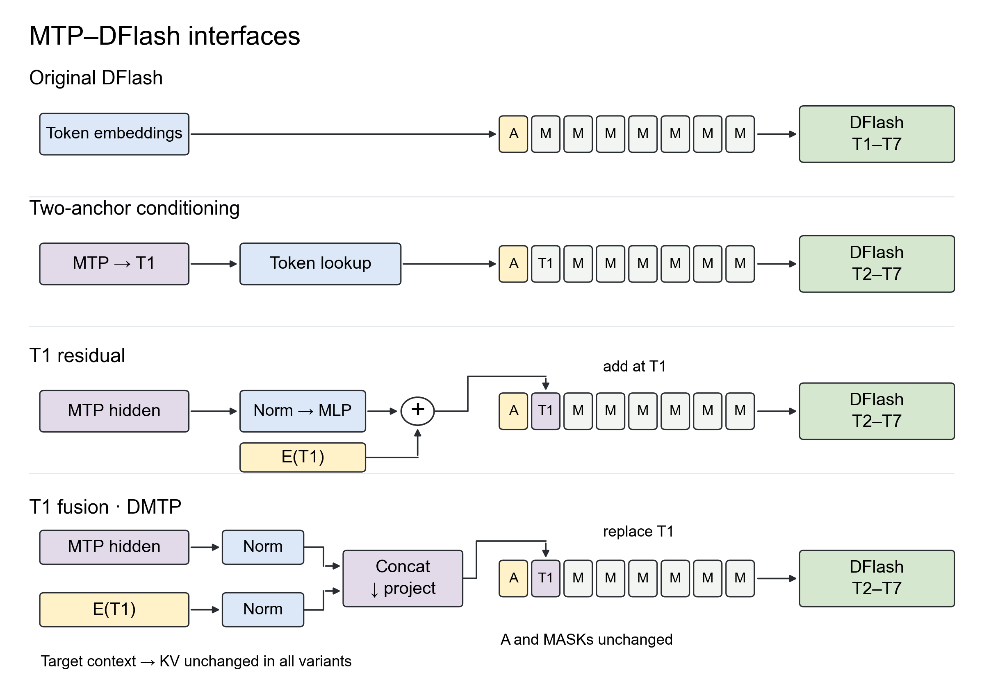
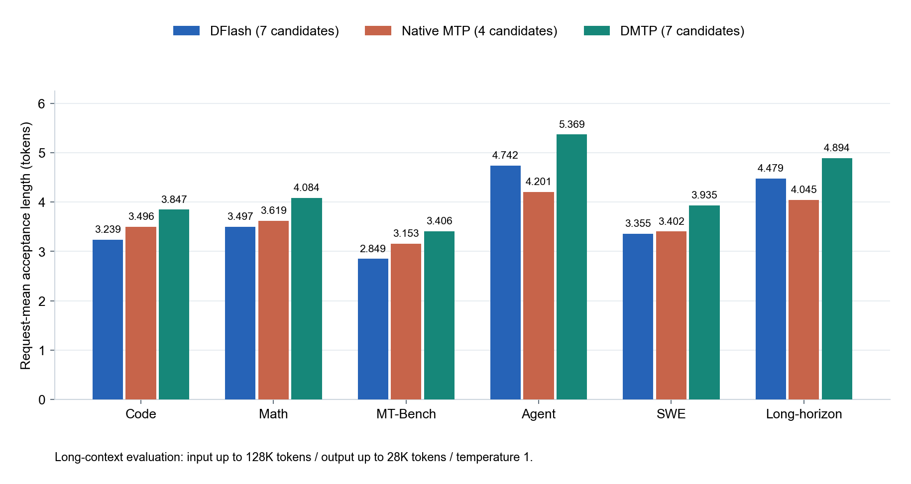
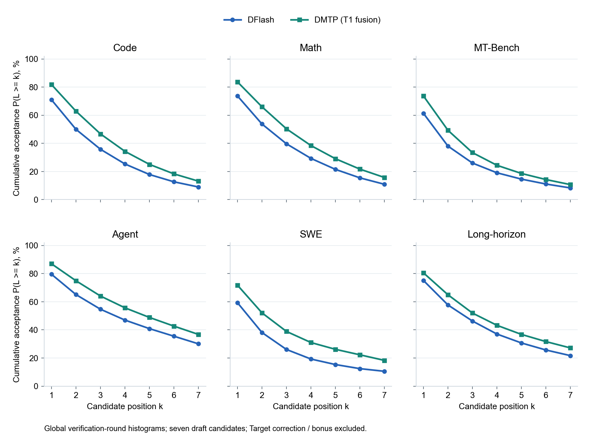
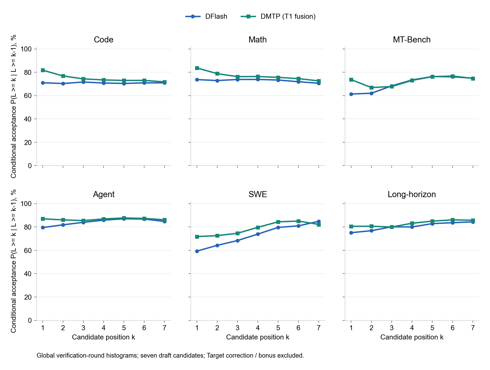

# DMTP：让预训练 MTP 为并行 Draft 开个好头

**Yuhao Shen · 2026 年 10 月 · 探索笔记**

投机解码已经成为当前大模型推理基础设施中的一个重要组件。过去一年，[DFlash](https://z-lab.ai/projects/dflash/) 一类的模型展现出了很大的潜力，DeepSeek 也已经在生产服务中采用 [DSpark](https://arxiv.org/abs/2607.05147)，并报告了相比原有 MTP-1 方案的明显收益。但在我的一些尝试中，以及最近和 Domino 作者 Jianuo Huang（佳诺）关于 MTP 与 DFlash 现状的讨论中，我们发现：对于 GLM、Qwen 这类原生 MTP 训练充分的模型，或者某些 chat 场景，DFlash 相比 MTP 并不总有显著优势。

进一步测试后，我们发现两者恰好各有所长：原生 MTP 的首 token 接受率更高，在 OOD 场景下尤其明显；DFlash 则能并行生成更长的续写。能不能把 MTP 的预训练首位能力与 DFlash 的并行预测结合起来？

针对DFlash类模型在block内后续位置接受率逐渐衰减的问题，已有多种改进方案。**我们关注的是另一个问题：能不能先把第一个draft token的接受率提上去？** 在前缀验证下，首位被拒绝，后面的候选就无法在本轮提交。DMTP从预训练MTP的首位预测出发，再把它的hidden传给DFlash，帮助后续并行续写。

我们提出 **DMTP**：由预训练 MTP 生成第一个候选，再由 DFlash 并行生成后续候选。本文选择 **MTP 式词元与隐藏状态融合**作为主方法，将预测 T1 的 MTP 隐藏状态与 T1 词嵌入分别归一化、拼接投影，在 T1 输入位置连接预训练表示与并行续写。

> **核心思路：** 让 MTP 为生成开个好头，让 DFlash 并行完成续写。两者既共享候选 token，也通过预测表示建立联系，而不必替换各自的主干。

## 核心观察

- **复用预训练首位能力。** 图1中，原生MTP在各类任务上均有更高的首位接受率。DMTP将这一首位能力与DFlash并行续写结合。
- **MTP负责首位，DFlash负责并行续写。** 复用MTP充分预训练的首位预测能力，并控制串行draft latency；多个MTP token与自适应步数是后续扩展方向。
- **预测与表示协同。** MTP 提供首个候选，并将预测表示传给并行续写模块。我们分别评估候选条件与表示注入的贡献。
- **用生成时的接受长度检验表示接口。** 在 Code 的 8 条输入对照中，MTP 式词元与隐藏状态融合的平均接受长度为 **3.963**，仅使用候选词元的双锚点对照为 **3.770**。

## 1. 首位接受率与并行 Draft

图1比较同一 Target 模型上的 **DFlash 与原生 MTP**。DFlash 使用混合任务数据训练，训练长度为 32K；MTP 使用同一 Target 自带的预训练权重。

两组采用相同的Qwen3.6-35B-A3B target和输入集合，覆盖Code、Math、MT-Bench、Agent、SWE、Long-horizon六类负载。**DMTP组合只用MTP生成T1，后续六个候选由DFlash并行生成。**



*图 1：Qwen3.6-35B-A3B 在六类任务上的首 token 接受率，生成温度为 1。*

Code 上，DFlash 与 MTP 的首位接受率分别为 71.00% 和 82.32%。

**首 token 优势的一个直观解释，就是原生 MTP 经历了大量预训练。** 它的第一步预测随 Target 在大规模数据上得到充分训练，训练覆盖远超过我们单独训练的 DFlash draft，因此具备更扎实的预测基础与泛化能力。

我们更愿意把这一差距理解为复用预训练能力的机会，而不是 MTP 架构天然更优的证明。DMTP 的出发点，就是利用这份已有的训练积累，再通过 MTP hidden 将其传给后续并行预测。

因此，一个自然的问题是：**如何把 MTP 首 token 的预训练能力，与 DFlash 的 block 并行预测能力结合起来？** 我们不必在两者之间二选一，而是让 MTP 负责开头，再由 DFlash 并行续写。

## 2. DMTP：第一步用 MTP，后六步交给 DFlash

最直接的分工是：

```text
MTP：生成 T1
DFlash：以 T1 为条件，一次生成 T2～T7
Target：验证七个候选，提交接受前缀与修正/bonus
```



*图 2：上方为原版 DFlash；下方为 DMTP，按从左到右的顺序执行：MTP 生成 T1，将 MTP hidden 与 T1 的词嵌入融合，再由 DFlash 并行预测 T2～T7，最后统一验证。上方支路保留原 Target context → KV 路径。T1 的词嵌入来自 token 查表，不是 Target 在 T1 位置的 hidden。*

这个组合有三点吸引力。

**首先，复用已经很强的首位能力。** 原生 MTP 冻结，不再让新 draft 训练改变它的第一步预测。首位更可靠，才有机会兑现后续候选的价值。

**其次，为DFlash提供更近的预测起点。** 给定T1后，原本的第二个未来token变成新anchor后的第一个待预测位置。DFlash以T1为条件生成后续候选，完整候选块统一交给target验证。

**最后，把MTP的预训练表示传给DFlash。** T1提供离散的预测结果；MTP hidden则带来预训练中学到的特征。我们希望后续DFlash位置能利用这些特征，改善泛化与接受长度。这与“MTP负责首token”本身的收益是两个需要分别验证的点。

### 单步 MTP 预测

只用 MTP 生成 T1，既保留了预训练最充分的首位能力，也控制了串行 draft 开销。生成更多 MTP 候选需要连续执行前向与选词，而 DFlash 能一次并行预测后六位；额外的 MTP 步数，只有在接受收益覆盖执行成本时才值得引入。多 token MTP 与自适应步数仍是后续值得探索的扩展。

## 3. MTP 表示的注入方式

接下来的问题是：如何把 MTP 的表示传给 DFlash？本文以 **MTP 式词元与隐藏状态融合**为主方法，并通过实际生成的接受长度，对比候选条件输入和不同表示接口。

设 \(A = x_a\) 是 Target 已经输出、但尚未处理的 pending token。Target context 截止 \(x_{a-1}\)。MTP 读取上一位置的 Target hidden 与 \(A\)，得到用于预测 \(T_1 = x_{a+1}\) 的表示。不需要 Target 处理 \(A\) 或 \(T_1\) 后的 hidden。

融合使用的就是**预测 T1 时的 MTP hidden**，不是消费 T1 之后的下一份 hidden：

$$
\widetilde{\mathbf e}_{T_1}=W_f\left[\operatorname{RMS}_e(\mathbf e_{T_1});\operatorname{RMS}_m(\mathbf h_{\mathrm{MTP}})\right].
$$

两路 2048 维特征独立使用可学习 RMSNorm，再经 4096→2048 线性投影。只用融合结果替换 T1 的 embedding；A 与六个 MASK 的 embedding 保持原样，Target context 继续走原 FC→KV 路径，不增加 MTP KV 槽位。

### MTP 式融合的设计

**沿用原生 MTP 的接口形式。** 原生 MTP 将词元嵌入与隐藏状态分别归一化、拼接，再线性投影。主方法借鉴同一结构，将具体候选 T1 与预测它的表示结合起来，但使用独立训练的融合参数，不直接复制原生 MTP 的投影权重。

**让表示与具体候选绑定。** E(T1) 提供实际选中的 token 身份，MTP hidden 提供预测这个 token 时的内部表示。六个 MASK 通过 attention 读取融合后的 T1，而不是各自接收同一份加性残差。

**保留原上下文路径。** 词元与隐藏状态融合不重写历史上下文，也不改变原 DFlash 主干或候选预算，便于复用已有模型与推理实现。

### 双 Anchor 条件输入

> **两个已知输入，七个候选。** A 已经由 Target 输出；T1 才是本轮 MTP 提出的新候选，仍可能被拒绝。送去验证的七个候选是 T1～T7。

**A 补齐历史与续写之间的边界。** 此时 Target context 还没有覆盖 A。去掉它，不只是少一个输入槽位，而是拿掉了最后一个已输出 token 的显式信息，DFlash 需要从 MTP hidden 中间接恢复这段边界。保留 E(A)，则直接提供准确的 token 身份，避免因边界信息缺失而损害后续预测。

**T1 明确这一块要接着哪个候选续写。** MTP hidden 包含预测信息，但不能代替具体选出的 token。显式输入 T1，让六个 MASK 都能通过 attention 读取同一个候选，而不必再推断应该沿着哪个可能的首 token 展开。

**双 anchor 为并行续写提供了更明确的前缀。** A 确定历史的最后一个 token，T1 确定本轮要延续的候选分支，六个 MASK 共享这两个显式条件，不必同时恢复边界和猜测首 token。这不是降低采样温度，也不意味着 T1 已经通过验证。

我们以原始 DFlash 衡量 MTP 首位预测与双锚点续写的整体收益，再固定双锚点布局，比较额外传递 MTP 表示的作用。



*图3a：八个输入槽位、七个候选。A已输出，T1由MTP生成，T2～T7由DFlash生成。A与已知T1槽位都不计算draft预测loss。*

### 消融设计

- **原始 DFlash。** 单锚点外部基线，输入为 `[A,MASK×7]`，由 DFlash 提出全部七个候选。
- **仅使用候选词元的双锚点。** `[A,T1,MASK×6]`，不额外注入 MTP 隐藏状态；仍使用原目标模型的隐藏状态上下文。
- **隐藏状态残差（首个候选位置）。** MTP 隐藏状态经低秩网络得到残差，只加到 T1 词嵌入，六个掩码输入保持不变。
- **MTP 式词元与隐藏状态融合（主方法）。** MTP 隐藏状态与 E(T1) 分别归一化、拼接投影，只替换 T1 词嵌入。

补充对照包括六个掩码位置的隐藏状态残差、目标模型与 MTP 上下文融合，以及仅使用 MTP 上下文。上下文融合将五路目标模型特征与逐位置 MTP 特征拼接，进行 6H→H 投影。所有 DMTP 组均保留 A 与 T1。



*图3b：仅展示主表四种方式，依次为原始 DFlash、仅使用候选词元的双锚点、首个候选位置的隐藏状态残差，以及 MTP 式词元与隐藏状态融合。四者均保留原目标模型上下文路径，候选预算均为七个；后两种分别在首个候选位置采用加性残差与替换式融合。*

仅提供候选 token 的对照，用于衡量 MTP 内部表示带来的额外收益。

### 推理消融：Code 接受长度

我们在相同的 8 条代码任务输入上比较不同表示接口，固定模型、候选数量与生成设置。

| 方法 | 表示接口 | Code 接受长度 | 相对双锚点对照 |
| --- | --- | --- | --- |
| 原始 DFlash | 单锚点，七个候选 | 3.360 | -10.89% |
| 仅使用候选词元的双锚点 | 无额外 MTP 隐藏状态注入 | 3.770 | +0.00% |
| 隐藏状态残差（首个候选位置） | MTP 隐藏状态残差只加到首个候选输入 | 3.864 | +2.48% |
| **MTP 式词元与隐藏状态融合（主方法）** | **仅替换首个候选词元的输入表示** | 3.963 | +5.12% |

**MTP 式词元与隐藏状态融合进一步提升接受长度 5.12%。** 先由 MTP 生成首个候选、再以双锚点续写，接受长度从原始 DFlash 的 3.360 提高到 3.770（+12.22%）。融合预测表示后，主方法达到 3.963。首个候选位置的隐藏状态残差方案为 3.864，高于候选条件对照 2.48%。

*表中为 8 条 Code 输入的平均接受长度，包含 Target 修正/bonus。主表使用统一适配路径；补充表中的六个掩码位置残差采用独立服务实现。*

<details>
<summary>补充对照：其他表示接口</summary>

| 方法 | 表示接口 | Code 接受长度 | 相对双锚点对照 |
| --- | --- | --- | --- |
| 隐藏状态残差（六个掩码位置） | MTP 隐藏状态残差加到六个掩码输入 | 3.842 | +1.92% |
| 目标模型与 MTP 上下文融合 | 五路目标模型特征与 MTP 特征拼接投影 | 3.714 | -1.49% |
| 仅使用 MTP 上下文 | 由逐位置 MTP 特征提供上下文 | 3.565 | -5.43% |

</details>

### 预测复用与表示传递

**MTP 的预训练能力已经在输出层面得到复用：它负责生成 T1。** 仅使用候选词元与额外融合隐藏状态的对照，进一步检查候选词元之外的表示收益，而不是把原始 DFlash 到主方法的全部变化都归给隐藏状态。

不同接口决定了 DFlash 在什么位置、以什么形式读取 MTP 信息。表示本身与注入位置需要共同设计。

MTP 式词元与隐藏状态融合在本轮 Code 对照中取得了最高接受长度，同时沿用了原生 MTP 的归一化与拼接投影结构，将具体候选与其预测表示绑定在同一个输入位置。

### 与现有 Draft 方法的兼容性

**MTP 式词元与隐藏状态融合保留原 DFlash 主干与目标模型上下文接口。** 可以加载配置匹配的主干并训练新的 T1 融合模块，Target 与 MTP 保持冻结。

微调时新增并训练 T1 融合模块，输入采用 `[A,T1,MASK×6]`，监督后六个预测位置。

DMTP 改的是 MTP 与 DFlash 的协作方式，保留了两者的主干。因此，更强的 MTP、DFlash loss、path selector 与推理 kernel 都可以在这一组合上继续探索。

**DMTP 保留原生 MTP 与 DFlash 主干，通过轻量的表示接口连接两者。** 这一设计可以复用已有训练配方，也便于与更强的预测头和推理实现结合。

### 早期 MTP Layer 实验

7、8月我们曾复制MTP layer，以DFlash方式训练并行预测。联合训练影响了首位表现，收敛收益有限。当前先冻结预训练首位能力，再围绕它训练并行续写。

## 4. DMTP 训练流程

实验使用 Qwen3.6-35B-A3B 与混合任务数据，主要覆盖软件工程和长程任务，训练长度 32K、规模约 25 万条。对话与智能体任务用于评测泛化表现。

训练分为三步：

1. **提取冻结特征。** Target 处理训练序列；在每个 block 边界，MTP 读取 A 与上一位置的 Target hidden，得到预测 T1 的表示。DFlash context 只使用 A 之前的 Target 特征。
2. **构造 Draft 输入。** 使用 `[A,T1,MASK×6]`，其中 T1 取自训练数据。E(T1) 与预测 T1 的 MTP hidden 分别归一化、拼接投影，替换 T1 embedding，六个 MASK 不变。
3. **优化后续预测。** DFlash 沿用原位置衰减 CE，学习 T2～T7。Target 与 MTP 冻结，只更新 DFlash 与 T1 融合模块；A 和已知 T1 输入槽位不计算 draft 预测 loss。

训练使用 <mark>GT T1</mark>，推理使用 MTP 实际生成的 T1，因此仍有这部分训推差异。Hidden 路径保持一致：使用预测 T1 时的 MTP 表示，而不是消费 T1 之后的 hidden。

## 5. 推理流程：先 MTP，再 DFlash

每一轮生成都按图 2 的顺序执行：

1. **MTP 生成 T1。** 读取已有的 Target hidden，消费 pending token A，保留选出的 T1 以及预测它时的 MTP hidden。
2. **DFlash 预测 T2～T7。** 构造 `[A,T1,MASK×6]`，融合 E(T1) 与预测它的 MTP hidden，只替换 T1 embedding，再运行一次并行 DFlash 前向。
3. **Target 统一验证。** 一起验证 T1～T7，提交接受前缀及修正/bonus token，再进入下一轮。

运行时分别维护 MTP 与 DFlash 状态，只提交接受的历史，回退被拒绝候选产生的临时状态。

新增计算包括一次 MTP 前向、首位 LM head，以及两路归一化和一次 T1 融合投影。Target context 与 DFlash 的 attention 长度保持不变。

系统优化聚焦状态更新、执行调度与 CUDA Graph 覆盖，减少两阶段衔接的额外成本。

## 6. 主方法的六类生成评测

我们在涵盖代码、数学、对话、智能体、软件工程与长程任务的长上下文基准上评测 DMTP，并与 DFlash 和原生 MTP 比较。输入长度上限为 **128K**，输出长度上限为 **28K**；各方法使用相同输入，生成温度为 1。

| 负载 | DFlash接受长度 | 原生MTP接受长度* | DMTP接受长度 | DMTP相对DFlash |
| --- | --- | --- | --- | --- |
| Code | 3.239 | 3.496 | 3.847 | +18.78% |
| Math | 3.497 | 3.619 | 4.084 | +16.78% |
| MT-Bench | 2.849 | 3.153 | 3.406 | +19.56% |
| Agent | 4.742 | 4.201 | 5.369 | +13.22% |
| SWE | 3.355 | 3.402 | 3.935 | +17.29% |
| Long-horizon | 4.479 | 4.045 | 4.894 | +9.25% |

*原生 MTP 提出 4 个候选，DFlash 与 DMTP 均提出 7 个候选。*

*平均接受长度包含 Target 的修正或 bonus token。*



*图 5：DMTP 在六类任务上的平均接受长度相对 DFlash 提高 9.25%～19.56%。*

### 逐位置接受率

图6将同一轮生成评测展开到T1～T7，观察首位收益能沿前缀保留多远。



*图 6：逐位置累计接受率 P(L≥k)，即每轮验证中前 k 个 draft 候选全部接受的比例，不包含修正/bonus。评测设置同上。*

DMTP 在六类任务的 T1～T7 位置均获得了更高的累计接受率，表明首位增强与后续并行预测可以共同提升整个候选块的接受表现。

<details>
<summary>条件接受率：已经接受前k−1个候选后，第k个继续接受的比例</summary>

条件接受率描述到达某个位置后，继续接受下一个候选的概率。



| 数据集 / 模型 | 验证轮数 | T1 | T2 | T3 | T4 | T5 | T6 | T7 |
| --- | --- | --- | --- | --- | --- | --- | --- | --- |
| Code / DFlash | 523201 | 71.00% | 70.38% | 71.64% | 70.79% | 70.43% | 70.91% | 70.97% |
| Code / DMTP（T1融合） | 434780 | 81.81% | 76.83% | 74.34% | 73.43% | 73.00% | 73.02% | 71.76% |
| Math / DFlash | 473538 | 73.73% | 72.93% | 73.82% | 73.87% | 73.36% | 71.90% | 70.59% |
| Math / DMTP（T1融合） | 404689 | 83.72% | 78.84% | 76.25% | 76.36% | 75.64% | 74.54% | 72.62% |
| MT-Bench / DFlash | 54479 | 61.36% | 62.04% | 68.34% | 73.36% | 76.38% | 76.11% | 74.92% |
| MT-Bench / DMTP（T1融合） | 41259 | 73.72% | 66.90% | 67.78% | 73.03% | 76.24% | 76.77% | 74.74% |
| Agent / DFlash | 22213 | 79.53% | 81.84% | 84.00% | 85.87% | 87.05% | 86.81% | 84.74% |
| Agent / DMTP（T1融合） | 17371 | 86.98% | 86.12% | 85.51% | 86.91% | 87.72% | 87.34% | 86.18% |
| SWE / DFlash | 4795 | 59.33% | 64.25% | 68.38% | 73.92% | 79.65% | 80.98% | 84.90% |
| SWE / DMTP（T1融合） | 3836 | 71.79% | 72.59% | 74.64% | 79.69% | 84.44% | 85.06% | 82.20% |
| Long-horizon / DFlash | 2919 | 75.13% | 76.84% | 80.18% | 80.01% | 82.89% | 83.71% | 84.40% |
| Long-horizon / DMTP（T1融合） | 2798 | 80.56% | 80.66% | 79.98% | 83.22% | 85.04% | 86.10% | 85.78% |

</details>

整体上，首位增强与条件化并行续写提高了组合的接受长度。进一步加速需要降低新增MTP阶段的执行成本。

## 7. 后续方向

我们还想继续探索几个方向：

- **统一MTP与DFlash的训练范式。** 能否把两者放到同一个框架下，进一步理解首token接受率和后续位置衰减差异背后的原因？
- **联合训练。** MTP不一定要冻结，也可以和DFlash一起训练，研究如何在保留首位优势的同时提升整个block的预测能力。
- **多层MTP做block预测。** 能否让多层MTP学习block预测，将已有的预训练能力与并行draft结合起来？
- **更高效的推理链路。** 继续优化KV管理、CUDA Graph和执行调度，降低两者组合后的额外开销。
- **更大的模型。** 将 DMTP 扩展到更大规模的 Target，探索不同的 MTP–DFlash 组合，检验其在更大模型上的泛化能力与加速潜力。

DMTP 仍是一次初步探索。我们将继续分享更大模型上的实验结果，相关论文与开源代码也将于近期公开。

## 参考资料

1. [DFlash: Block Diffusion for Flash Speculative Decoding](https://z-lab.ai/projects/dflash/)
2. [DSpark: Confidence-Scheduled Speculative Decoding with Semi-Autoregressive Generation](https://arxiv.org/abs/2607.05147)
3. [SpecForge v0.3.0](https://www.lmsys.org/blog/2026-08-04-specforge-v0-3)

## 致谢

感谢 **Qwen Team、GLM/Domino Team 和 Qwen Application Team** 的支持与交流。这项工作是在我于 **Qwen Infra 团队实习期间**完成的。

**Qwen Team**：Yuhao Shen、Di Liu、Yucheng Li、Hao Yu、Yang Xu、Xi Lin、Yi Zhang。

**GLM/Domino Team**：Jianuo Huang。

**Qwen Application Team**：Tianyu Liu、Jun Zhang。

## 引用

如果这项工作对你有帮助，欢迎引用这篇技术博客：

```bibtex
@misc{shen2026dmtp,
  author = {Shen, Yuhao},
  title  = {{DMTP}: A Better First Token for Block Drafting via MTP},
  year   = {2026},
  note   = {Exploration note}
}
```
